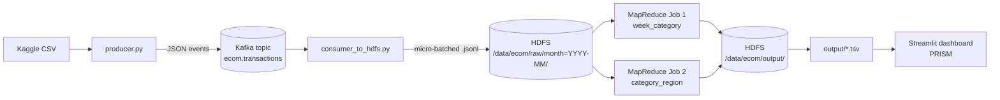

# PRISM

### Streaming Return-Rate Analytics with Kafka, HDFS and MapReduce
*(BDA Lab Project #28 — Product Return-Rate Pattern Analysis)*

Stream e-commerce order/return events through **Kafka**, store them in **HDFS**, compute the weekly
return rate per product category with **MapReduce** (Hadoop Streaming, Python), and flag any
category above **10%** on a **Streamlit dashboard**.

```
CSV --> producer.py --> Kafka (ecom.transactions) --> consumer_to_hdfs.py --> HDFS /data/ecom/raw/month=YYYY-MM/
                                                                                    |
       dashboard (Streamlit) <-- output/*.tsv <-- HDFS /data/ecom/output <-- MapReduce jobs (YARN)
```



## Definitions (use these exact words in the report)
- **Return rate (week, category)** = return requests / orders, for orders *placed* in that ISO week (cohort view, never above 100%).
- **Flag** = `HIGH` when rate > 10% **and** the cell has at least 10 orders (noise guard).
- **Returned value** = price x quantity of returned orders - the "return cost" finance cares about.
- Job 1 `week_category`: weekly rate per category. Job 2 `category_region`: where returns concentrate.

## 0. Try the logic in 60 seconds (no Docker needed)
```bash
pip install -r requirements.txt
bash scripts/local_test.sh            # fake data -> events -> mapper|sort|reducer -> pandas cross-check
```
Expect `PASS: all ... groups match between pandas and MapReduce`. Anyone on the team can run this.

## 1. Real dataset
**Done** — see [`docs/dataset_profile.md`](docs/dataset_profile.md). Source: Kaggle
[**"E-commerce Sales Transactions Dataset"**](https://www.kaggle.com/datasets/miadul/e-commerce-sales-transactions-dataset)
by Arif Miah (34,500 orders, 17 columns, genuine `returned` column — Kaggle requires sign-in to download,
so grab it manually and drop it in `data/raw/`, it's gitignored). No category is above 10% overall, but
**72 of 735 weekly category cells are flagged HIGH** — use the weekly view for the demo, not the overall table.
```bash
python ingestion/prep_data.py --input data/raw/<file>.csv
```
It auto-detects column names and prints a profile (rows, date range, return rate per category) for the report.
If a column isn't found it tells you which one; add the header name to `ALIASES` in `prep_data.py`.
`scripts/make_synthetic.py` makes a FAKE stand-in with the same shape - for testing only, never report it as real.

## 2. Bring up the cluster
```bash
docker compose build        # first time, ~10 min (downloads Hadoop)
docker compose up -d
bash scripts/init_cluster.sh
docker exec nodemanager python3 --version      # MUST print a version (Streaming needs it)
```
UIs: HDFS http://localhost:9870 - YARN http://localhost:8088. Give Docker >= 6 GB RAM.
No Docker? Use one Ubuntu VM with Kafka + Hadoop installed natively; the Python code is unchanged
(set `KAFKA_BOOTSTRAP`, and change the `docker exec namenode ...` calls in `consumer_to_hdfs.py` / `run_jobs.sh` to local `hdfs` commands).

## 3. Run the pipeline
```bash
pip install -r requirements.txt
bash scripts/run_pipeline.sh          # or step by step:
python ingestion/consumer_to_hdfs.py --sink hdfs --idle-exit 25 &
python ingestion/producer.py --rate 1000
bash scripts/run_jobs.sh              # writes output/week_category.tsv, output/category_region.tsv
python scripts/verify_with_pandas.py
streamlit run dashboard/app.py
```

## Team roles
| | Owner | Files |
|---|---|---|
| A | Infra | `docker-compose.yml`, `hadoop/`, `scripts/init_cluster.sh`, `run_pipeline.sh` |
| B | Ingestion | `ingestion/*`, data cleaning, schema (`docs/event_schema.md`) |
| C | MapReduce | `mapreduce/*`, `scripts/run_jobs.sh`, `verify_with_pandas.py` |
| D | Dashboard + docs | `dashboard/app.py`, report, PPT, architecture diagram |

## Day 1 checklist (done = ticked + pushed to Git)
- [x] **All:** clone repo, `pip install -r requirements.txt`, `bash scripts/local_test.sh` passes
- [x] **A:** `docker compose up -d` works; HDFS/YARN UIs open; `nodemanager python3 --version` OK; topic created; share any compose fixes via Git
- [x] **B:** real Kaggle CSV downloaded; `prep_data.py` run; profile pasted into `docs/dataset_profile.md`; return column confirmed genuine (no `--synthesize-returns` needed)
- [ ] **C:** read `rr_mapper.py` / `rr_reducer.py` line by line and explain them to the team; run them on the real cleaned data via `local_test.sh data/raw/<file>.csv` (logic already verified against real data, pandas cross-check PASSed — still read the code together)
- [ ] **D:** run the dashboard on sample data; take the first screenshots; architecture diagram above is a draft - polish it; fill in [`docs/report_outline.md`](docs/report_outline.md)

## Known risks / things that may need a tweak on first run
- `hadoop/Dockerfile` build verified working. It originally pulled from `archive.apache.org` (no CDN —
  took 12+ minutes and counting before being swapped); it now tries `dlcdn.apache.org` first with the
  archive as fallback. Build + `docker compose up -d` + `init_cluster.sh` all confirmed working end to end.
- **Windows Git Bash only:** MSYS rewrites POSIX-looking args like `/data/ecom/raw` into Windows paths
  (`C:/...`) before they reach `docker.exe`, breaking every `docker exec ... hdfs dfs ...` call with
  `No FileSystem for scheme "C"`. Fixed by exporting `MSYS_NO_PATHCONV=1` in the affected scripts
  (`init_cluster.sh`, `run_jobs.sh`, `run_pipeline.sh`). If you hit this error anywhere else, that's why.
- Kafka listeners: scripts on your laptop use `localhost:9092`; anything inside Docker uses `kafka:19092`.
- Small-files problem: raw data is partitioned by month on purpose, and the jobs use `CombineTextInputFormat`. Good viva answer.
- Weekly flags depend on the data: check how many `HIGH` rows exist after `prep_data.py`. Zero flags = a boring demo, so look early. (Confirmed non-zero on the real dataset: 72/735 — see `docs/dataset_profile.md`.)
- Docker Desktop on Windows has, at least once, silently dropped all running containers (not just
  stopped them — `docker ps -a` showed nothing) during a long build. If `docker compose ps` comes up
  empty after it was previously up, just `docker compose up -d` again; the built image is cached so
  it's fast. Not yet root-caused — flag it if it recurs.
