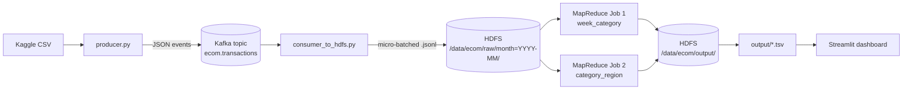

# PRISM

**Streaming Return-Rate Analytics with Kafka, HDFS and MapReduce**

PRISM is a big-data pipeline that identifies which e-commerce product categories are driving return
costs, computed weekly instead of in quarterly batch reviews. Order and return events are streamed
through Kafka, landed on HDFS, aggregated with a Hadoop Streaming MapReduce job, and surfaced on a
Streamlit dashboard that flags any category-week with a return rate above 10%.

---

## What's implemented

| Area | Status | Details |
|---|---|---|
| Data cleaning | ✅ | `ingestion/prep_data.py` auto-detects source columns and normalizes them to a fixed schema |
| Event streaming | ✅ | `ingestion/producer.py` replays the dataset into Kafka as `order` / `return_request` JSON events |
| Kafka → HDFS sink | ✅ | `ingestion/consumer_to_hdfs.py` micro-batches events into `/data/ecom/raw/month=YYYY-MM/`, deduplicated |
| MapReduce aggregation | ✅ | `mapreduce/rr_mapper.py` + `rr_reducer.py` (Hadoop Streaming, with combiner) — weekly rate per category, plus a category × region hotspot job |
| 10% threshold flagging | ✅ | Reducer flags `HIGH` when rate > 10% and the cell has ≥ 10 orders (noise guard) |
| Dashboard | ✅ | Streamlit + Plotly — KPI tiles, weekly trend chart, category/region heatmap, flagged-cells table |
| Containerized cluster | ✅ | `docker-compose.yml` — single-broker Kafka (KRaft) + pseudo-distributed HDFS/YARN, one command to start |
| Real dataset loaded & profiled | ✅ | See [`docs/dataset_profile.md`](docs/dataset_profile.md) |
| Pandas cross-check | ✅ | `scripts/verify_with_pandas.py` independently recomputes every (week, category) rate and diffs it against the MapReduce output |

## Architecture



One beam of events goes in (Kafka), gets split and aggregated (MapReduce), and comes out the other
side as category-wise return rates (the dashboard) — hence the name.

## Tech stack

| Layer | Technology |
|---|---|
| Message streaming | Apache Kafka 3.7 (KRaft mode, no ZooKeeper) |
| Distributed storage | Apache Hadoop HDFS 3.3.6 (pseudo-distributed) |
| Batch compute | MapReduce via Hadoop Streaming (Python mapper/reducer + combiner) |
| Orchestration | Docker Compose |
| Ingestion / glue code | Python (`confluent-kafka`, `pandas`) |
| Dashboard | Streamlit + Plotly |

## Project structure

```
Prism/
├── docker-compose.yml       # Kafka + HDFS + YARN, single command to stand up the cluster
├── hadoop/                  # Custom Hadoop image (Ubuntu + JRE 11 + Python 3) and cluster config
├── ingestion/
│   ├── prep_data.py         # Cleans the raw Kaggle CSV into the pipeline's fixed schema
│   ├── producer.py          # Replays cleaned rows into Kafka as order/return events
│   ├── consumer_to_hdfs.py  # Kafka -> HDFS micro-batch writer
│   └── config.py            # Shared settings (topic, bootstrap servers, batching)
├── mapreduce/
│   ├── rr_mapper.py         # Emits (week|category, orders/returns) and (category|region, ...)
│   └── rr_reducer.py        # Aggregates, computes rate, applies the 10% HIGH flag
├── dashboard/
│   ├── app.py                # Streamlit app
│   └── sample_output/        # Pre-computed sample output so the dashboard runs before the pipeline does
├── scripts/
│   ├── local_test.sh         # End-to-end logic test with no Docker (mapper|sort|reducer vs. pandas)
│   ├── init_cluster.sh       # Creates HDFS dirs + Kafka topic after `docker compose up`
│   ├── run_pipeline.sh       # Full run: cluster up -> stream -> MapReduce -> verify
│   ├── run_jobs.sh           # Runs both MapReduce jobs, exports to output/*.tsv
│   ├── verify_with_pandas.py # Independent pandas recomputation, diffed against MapReduce output
│   └── make_synthetic.py     # Generates a fake stand-in dataset for testing only
├── docs/
│   ├── dataset_profile.md    # Dataset profile (source, columns, return-rate breakdown)
│   └── event_schema.md       # Kafka event schema reference
├── data/raw/                 # Drop the downloaded Kaggle CSV here (gitignored)
└── output/                   # Pipeline output TSVs land here (gitignored)
```

## Getting started

### 1. Try the logic — no Docker needed

Runs the mapper/reducer logic locally against fake data and cross-checks every result against
pandas. This is the fastest way to confirm your environment is set up correctly.

```bash
pip install -r requirements.txt
bash scripts/local_test.sh
```

Expect: `PASS: all ... groups match between pandas and MapReduce`.

### 2. Get the real dataset

Source: Kaggle [**E-commerce Sales Transactions Dataset**](https://www.kaggle.com/datasets/miadul/e-commerce-sales-transactions-dataset)
(34,500 orders, 17 columns, genuine `returned` column). Kaggle requires sign-in to download — grab
the CSV manually and place it in `data/raw/` (gitignored, so it won't be committed).

```bash
python ingestion/prep_data.py --input data/raw/<file>.csv
```

This auto-detects column names, cleans the data into `data/clean/transactions_clean.csv`, and prints
a profile (row counts, date range, return rate per category) — already captured for this dataset in
[`docs/dataset_profile.md`](docs/dataset_profile.md). No category is above 10% in the *overall*
aggregate, but **72 of 735 weekly category cells are** — use the weekly view, not the overall table,
when demoing the flagging feature.

> No real dataset handy yet? `python scripts/make_synthetic.py` generates a fake stand-in with the
> same shape, for pipeline testing only — never present it as real data.

### 3. Bring up the Kafka + Hadoop cluster

```bash
docker compose build        # first time only, downloads Hadoop (~700 MB)
docker compose up -d
bash scripts/init_cluster.sh
docker exec nodemanager python3 --version      # sanity check: must print a version
```

- HDFS UI: http://localhost:9870
- YARN UI: http://localhost:8088
- Give Docker at least 6 GB RAM.

No Docker available? Run Kafka + Hadoop natively on a single Ubuntu VM instead — the Python code is
unchanged; just set `KAFKA_BOOTSTRAP` and swap the `docker exec namenode ...` calls in
`consumer_to_hdfs.py` / `run_jobs.sh` for local `hdfs` commands.

### 4. Run the full pipeline

```bash
bash scripts/run_pipeline.sh
```

or step by step:

```bash
python ingestion/consumer_to_hdfs.py --sink hdfs --idle-exit 25 &
python ingestion/producer.py --rate 1000
bash scripts/run_jobs.sh              # writes output/week_category.tsv, output/category_region.tsv
python scripts/verify_with_pandas.py
```

### 5. View the dashboard

```bash
streamlit run dashboard/app.py
```

Reads from `output/*.tsv` if present, otherwise falls back to `dashboard/sample_output/` so the UI
can be reviewed before the pipeline has been run.

## Metric definitions

| Term | Definition |
|---|---|
| Return rate (week, category) | `return requests / orders`, for orders *placed* in that ISO week (cohort view — never exceeds 100%) |
| `HIGH` flag | Rate > 10% **and** the cell has at least 10 orders (noise guard against low-volume weeks) |
| Returned value | `price × quantity` of returned orders — the return cost finance cares about |
| Job 1 — `week_category` | Weekly return rate per category (the headline trend) |
| Job 2 — `category_region` | Category × region, for finding where returns concentrate |

## Results

From the real Kaggle dataset (see [`docs/dataset_profile.md`](docs/dataset_profile.md) for the full
breakdown):

- 34,500 orders, 1,903 returns, 5.52% overall return rate
- 735 (week, category) cells computed; **72 flagged `HIGH`**
- Highest overall-return-rate categories: Fashion (8.28%), Electronics (7.30%)
- Pandas cross-check: **PASS** — all 735 groups match between MapReduce and an independent pandas recomputation

## Troubleshooting

- **Hadoop image build speed**: `hadoop/Dockerfile` originally pulled the Hadoop tarball from
  `archive.apache.org` (no CDN, 12+ minutes for ~700 MB). It now tries the CDN-backed
  `dlcdn.apache.org` first, falling back to the archive if that mirror no longer has this version.
- **Windows Git Bash**: MSYS rewrites POSIX-looking arguments like `/data/ecom/raw` into Windows
  paths (`C:/...`) before they reach `docker.exe`, breaking every `docker exec ... hdfs dfs ...` call
  with `No FileSystem for scheme "C"`. Fixed by exporting `MSYS_NO_PATHCONV=1` in
  `init_cluster.sh`, `run_jobs.sh`, and `run_pipeline.sh`.
- **Kafka listeners**: scripts run from your host use `localhost:9092`; anything running *inside*
  Docker (e.g. the resourcemanager during a MapReduce job) uses `kafka:19092`.
- **Small-files problem**: raw data is intentionally partitioned by month, and the MapReduce jobs use
  `CombineTextInputFormat` to avoid excessive mapper overhead.
- **Docker Desktop (Windows)** has, at least once, silently dropped all running containers (not just
  stopped them) during a long build. If `docker compose ps` comes up empty after the stack was
  previously up, just run `docker compose up -d` again — the built image is cached, so it's fast.

